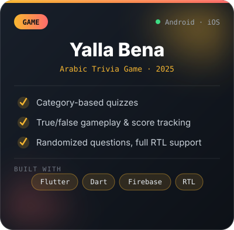
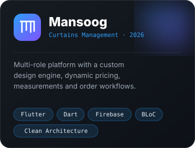
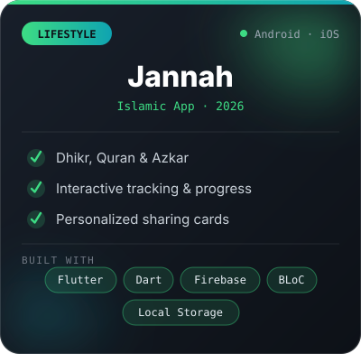

 

 

 

<table>
<tr>
<td width="50%" valign="top">

#### 🔭 Now
- Freelance Flutter Developer on **Freelancer & Mostaql**
- Shipping production-ready apps for clients
- Scaling with **BLoC / Cubit** and **Clean Architecture**

</td>
<td width="50%" valign="top">

#### 🌱 Next
- Native **Android** with Java & Kotlin
- **CI/CD** pipelines and modern workflows
- Advanced algorithms & competitive programming

</td>
</tr>
</table>

 

## ✨ Featured Projects

<table>
<tr>
<td width="33%" align="center" valign="top">

</td>
<td width="33%" align="center" valign="top">

</td>
<td width="33%" align="center" valign="top">

</td>
</tr>
</table>

**[See everything on my portfolio ➜](https://sayedmostafa.vercel.app/)**

 

## 🧰 Stack

 

## 💼 Experience

| When | Role | Where |
|---|---|---|
| **2024 → now** | **Freelance Flutter Developer** · Freelancer & Mostaql Cross-platform apps for clients with Firebase, Supabase, REST APIs and modern state management. | Remote |
| **Apr – Dec 2024** | **Mobile App Development Intern** · Digital Egypt Initiative Cross-platform apps with Flutter, Dart, Firebase and RESTful APIs. | Assiut |
| **2022 – 2026** | **B.Sc. Software Engineering** · Assiut National University GPA 3.33 / 4.00 | Assiut, Egypt |

 

## 🏆 Highlights

  

 

## 📊 GitHub

<picture>
  <source media="(prefers-color-scheme: dark)" srcset="https://github-readme-stats.vercel.app/api?username=sayedmostaf&show_icons=true&theme=transparent&title_color=2E9EF7&icon_color=7F52FF&text_color=c9d1d9&hide_border=true&include_all_commits=true&count_private=true">
  <source media="(prefers-color-scheme: light)" srcset="https://github-readme-stats.vercel.app/api?username=sayedmostaf&show_icons=true&theme=default&title_color=0175C2&icon_color=7F52FF&hide_border=true&include_all_commits=true&count_private=true">
  
</picture>
<picture>
  <source media="(prefers-color-scheme: dark)" srcset="https://github-readme-stats.vercel.app/api/top-langs/?username=sayedmostaf&layout=compact&theme=transparent&title_color=2E9EF7&text_color=c9d1d9&hide_border=true">
  <source media="(prefers-color-scheme: light)" srcset="https://github-readme-stats.vercel.app/api/top-langs/?username=sayedmostaf&layout=compact&theme=default&title_color=0175C2&hide_border=true">
  
</picture>

<!--
  OPTIONAL: animated contribution snake. Keep .github/workflows/snake.yml,
  run it once from the Actions tab, then uncomment this block.

<picture>
  <source media="(prefers-color-scheme: dark)" srcset="https://raw.githubusercontent.com/sayedmostaf/sayedmostaf/output/github-snake-dark.svg">
  <source media="(prefers-color-scheme: light)" srcset="https://raw.githubusercontent.com/sayedmostaf/sayedmostaf/output/github-snake.svg">
  
</picture>

-->

 

### Let's build something great together

